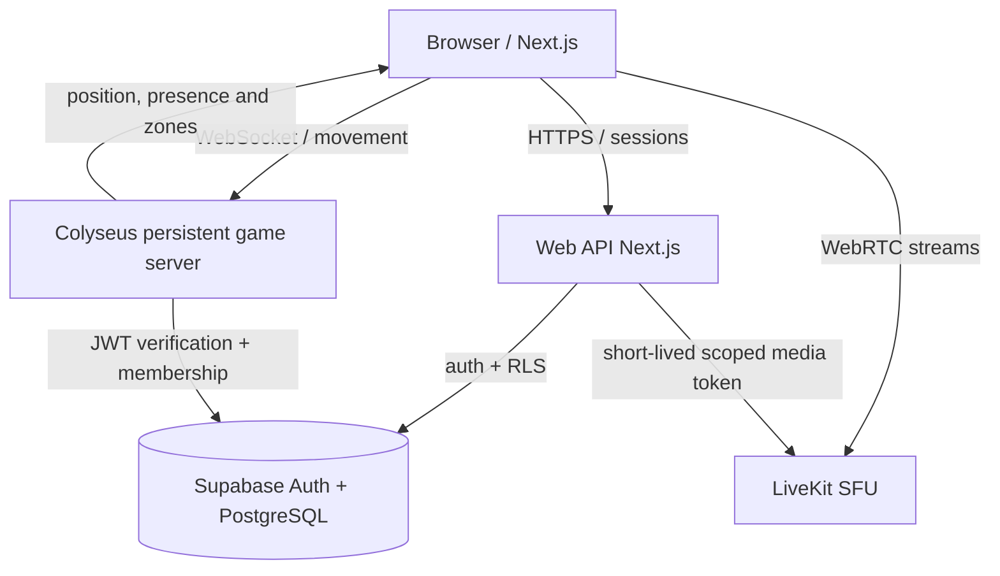

# Arquitetura — AZZO ROOM

## Objetivo do MVP

Um escritório 3D web com 5–10 participantes simultâneos por instância, dois modos de câmera, presença em tempo real, conversas informais por proximidade, reunião fechada com câmera/microfone/tela e vínculo por empresa. 5–10 é meta de teste de MVP, não é capacidade validada em produção.

## Visão de componentes

### Web

- React Server/Client Components Next.js; toda a cena 3D é `use client` e importada com `ssr:false`.
- React Three Fiber/Three.js: mapa, luzes, avatares; interpolação das posições remotas.
- `OfficeApp`: estado de UI e conexão; `OfficeWorld`: movimento/câmera; `VoiceManager`: LiveKit.
- Tecla **V**: posição e target de câmera interpolados em todo frame, sem cortes secos.
- Animação de avatar: placeholder geométrico; assets otimizados e animações GLB/glTF depois.

### Colyseus

- Instância `office` por workspace (`filterBy(['officeId'])` para agrupamento); **autorização também no backend**, nunca somente filterBy.
- Servidor é autoridade de estado. `move` recebido de cliente: deve validar dt, velocidade máxima, colisões e zona. No starter valida velocidade e limites gerais do mapa, mas não ainda colisão por móveis.
- Patch de estado `players` + `sessionId`; identidade de mídia é `userId` estável por sessão autenticada.
- Meta de taxa: inputs 10–20 Hz, sync 10–20 Hz, render ~60 FPS por interpolação. Ajustar com testes.

### LiveKit

- Canal geral da empresa: `workspace:{id}:office:{instance}` — somente para comunicação informal.
- Canal fechado de reunião: `workspace:{id}:meeting:{meetingId}` — token diferente, somente participantes autorizados.
- Voz espacial: `volume(d) = 1` quando d <= 1.2; `volume(d) = (1 - (d-1.2)/(8-1.2))²` quando 1.2 < d < 8; `volume(d) = 0` quando d >= 8.
- O volume client-side **não oferece privacidade**. Para reuniões, usar salas LiveKit separadas e negar tokens a não-membros.
- Tokens precisam ser gerados no servidor com identidade derivada da sessão, TTL curto e grants mínimos. Somente conceder `roomJoin` com a sala correta.
- Câmera/microfone somente mediante permissão do usuário. Usar opt-in explícito; saída e mute imediatos.

### Supabase (meta produção)

- `workspaces`: empresa, slug, owner.
- `workspace_members`: vínculo, papel (owner/admin/member/guest).
- `meeting_rooms`: salas da empresa e parâmetros de privacidade.
- `meeting_participants`: acesso individual ou convite.
- RLS reforça isolamento na camada de dados. Gateway/API e Colyseus devem replicar checagens de tenant.
- O arquivo SQL de migração é material de referência; não é executado pelo starter nem suficiente, sozinho, para tornar o jogo seguro.

## Fluxos essenciais

### Entrar no escritório

1. Usuário autentica pelo Supabase (futuro).
2. API verifica membership da empresa e fornece um ticket de curta duração para a instância Colyseus.
3. Client `joinOrCreate('office',{officeId,ticket})`.
4. `OfficeRoom.onAuth()` valida assinatura, expiração, identidade e permissão; ignora `userId`/nome como fonte de autoridade.
5. Servidor envia estado completo e patches de posições dos participantes.

### Conversa informal

1. Usuário clica "Ativar áudio".
2. API autenticada verifica sessão/membership e assina token somente da sala geral.
3. Browser conecta ao LiveKit e publica microfone se o usuário permitir.
4. Ao receber tracks remotas, calcula a distância pelas posições do servidor e ajusta volume.
5. Ao sair, remove a publicação/abandona room; não gerar mídia sem consentimento.

### Entrar em reunião privada

1. Usuário entra na zona da porta/mesa ou recebe convite.
2. Backend valida vínculo e participação na reunião; servidor de estado valida interação onde necessário.
3. API emite token de sala `meeting:{meetingId}`; client sai da sala geral e entra na sala fechada.
4. Painel de reunião oferece mic, câmera, tela, participantes e saída.
5. Ao sair, desconecta da sala privada e oferece reconexão à voz de escritório (se desejada).

## Segurança e operação

- No starter atual **não há login real**, então o jogo só libera ingressos de demo com env explícita em desenvolvimento; endpoint LiveKit de demo igualmente bloqueado em produção.
- Adicionar rate limit de joins/movements e proteção de abuso de LiveKit.
- Client pode apresentar movimento otimista; servidor reconcilia. Sem autoridade de backend, é possível atravessar móveis/forjar posição.
- Nas salas privadas, guest não pode acessar mídia só por conhecer o nome/ID da reunião.
- Logs não devem incluir áudio, vídeo, token de acesso ou secrets.
- Deploy: Vercel para Next; Colyseus em serviço de processo permanente; LiveKit Cloud; Supabase.

## Riscos de implementação

- **WebGL mobile:** detalhamento variável, limite de FPS e memória, joysticks virtuais e qualidade adaptativa.
- **Desempenho:** WebRTC e WebGL simultâneos; LOD, instancing, baked lighting, culling, compressão Draco/KTX2 e medição em dispositivos modestos.
- **Cross-platform:** suporte a Safari/Firefox, autoplay/mic permission, câmera e screen sharing por navegador.
- **Controle de privacidade:** volume client-side não impede a assinatura da mídia; usar sala fechada autorizada, renovação/revogação e opção de expulsar.
- **Transição ao escritório:** preservar áudio com opt-in e desligar ao navegar para fora do contexto permitido.

## Critérios de aceite MVP

- Dois navegadores veem avatares e posições corretas, respeitando workspace.
- V alterna de câmera sem perder controles ou criar uma segunda posição.
- Avatares param na parede/móveis após implementação física, também sob tentativa de manipular pacotes.
- A distância afeta volume nos dois lados; nenhuma pessoa em outra empresa consegue ouvir.
- Reunião privada impede acesso sem autorização, mesmo com ID conhecido.
- Reunião com dois usuários compartilha mic, câmera e tela quando ambos concedem permissão.
- 5–10 participantes simulados sem falhas graves, com métricas de FPS/latência registradas.
